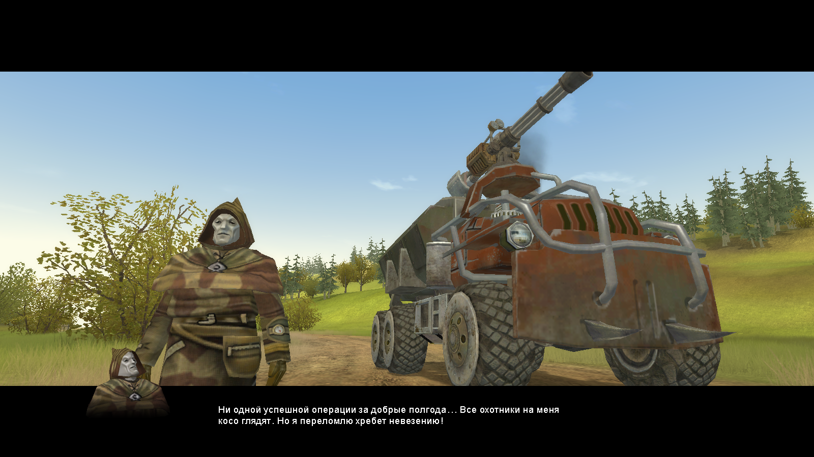
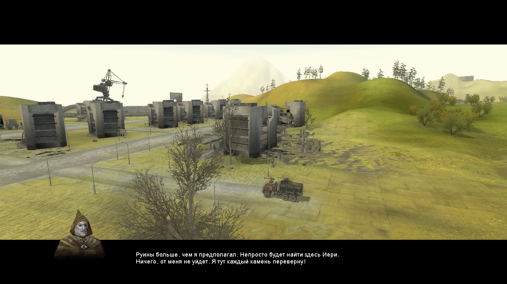
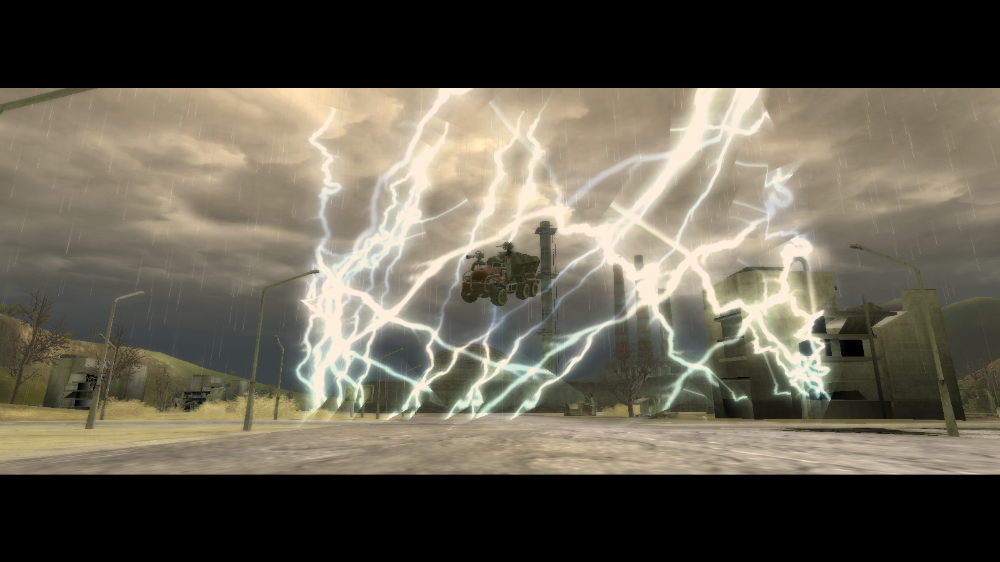
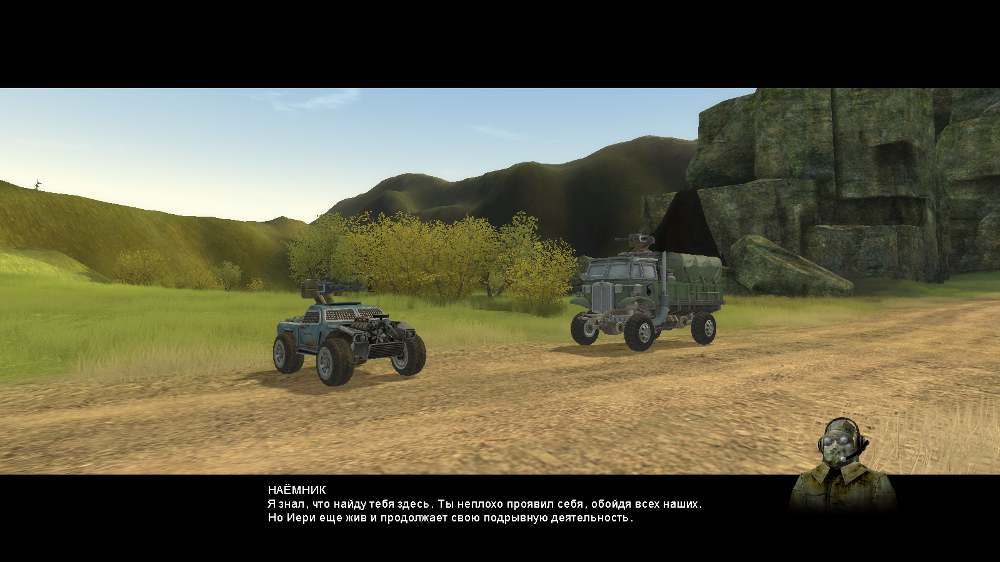

  

    
  

  <strong>🌐 Язык | Language</strong>

  

    
    
  

This mod ports the ExMachina Demo storyline to Community Remaster and also introduces a number of fixes and improvements to the game.

**Author - MrKarfen**

<h2>The full changelog</h2>

### Changes introduced by The Honor of a Mercenary
1. The ExMachina Demo storyline has been fully ported to Community Remaster.
2. Dialogs have been fixed and slightly improved.
3. Quest markers and descriptions have been fixed.
4. Cutscenes and scripts have been fixed and improved.
5. Music has been added to cutscenes that previously had none.
6. The volume of some lines in cutscenes has been adjusted.
7. Credits have been added after game completion (borrowed from Improved Storyline).
8. NPC path maps have been fixed.
9. The positions of some objects on the location have been fixed.
10. Weather and lighting on the location have been slightly improved.
11. Crates with random weapons have been added to the location.
12. New loading screens have been added.
13. Balance adjustments have been made.
14. Other minor changes and fixes.

#### Changes introduced by the “NPC and Quests” option
1. New side quests have been added that were not present in ExMachina Demo.

#### Changes introduced by the “New Main Character Combat Voice-Over” option
1. The main character's combat voice-over (lines when taking damage, killing enemies, etc.) has been replaced with a more suitable one. The original Ex Machina demo version used lines from the main game's protagonist, whose voice is very different from the demo protagonist's voice. If this option is disabled, the main character will remain silent in combat.

#### Changes introduced by the “Consumable Ammo” option
1. Weapons now have limited ammunition.
2. Ammo prices depend on caliber and weapon type.
3. The UI for displaying ammunition and the weapon group number has been updated.

<h2>Screenshots</h2>

## Download
The actual version of the modification can be downloaded on the [releases page](https://github.com/Comrade-Karfen/The-Honor-Of-A-Mercenary/releases).

## Installation
1. Install Community Remaster with all additional options.
2. In DEM Community Mod Manager, on the "Mods" tab, click "Add mod" and select the "The Honor Of A Mercenary" archive.
3. After it appears in the mod list, click "Unpack".
4. After unpacking, click "Install" and follow the mod manager's instructions.

## Useful Information
**New console commands have been added to the game:**

* givefuel () – fully refuels the player's vehicle.
* givehp () – fully repairs the player's vehicle.

## Credits
* **DEM team** – for Community Remaster
* **Pavel “pavlikrpg” Ivanov** – for permission to borrow the credits from Improved Storyline
