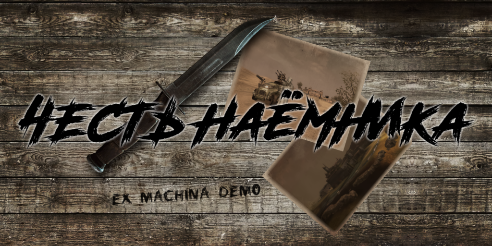
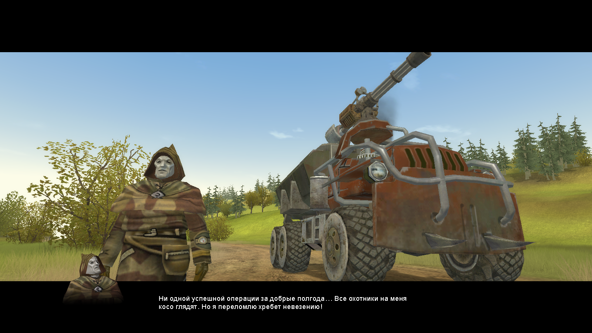
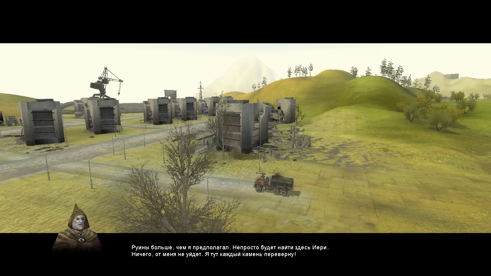
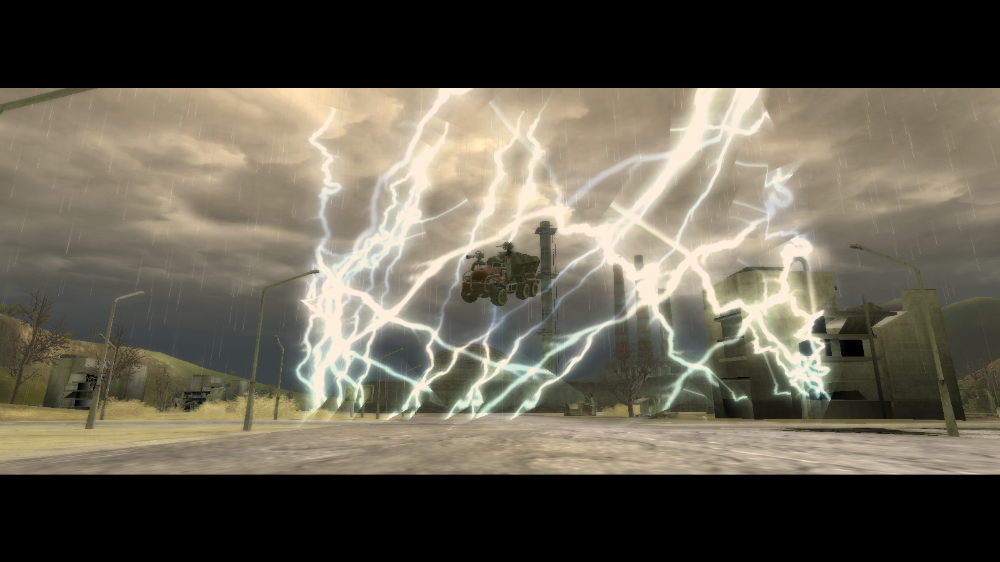
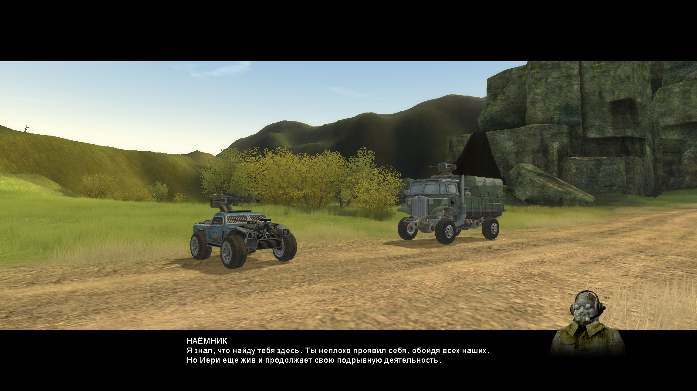

  

    
  

  <strong>🌐 Язык | Language</strong>

  

    
    
  

Данная модификация является переносом сюжета ExMachina Demo на Community Remaster. Помимо переноса сюжета "The Honor of a Mercenary" вносит в игру некоторые исправления и нововведения.

**Автор - MrKarfen**

<h2>Список изменений</h2>

# Изменения, вносимые The Honor of a Mercenary
1. Сюжет ExMachina Demo был полностью перенесен на Community Remaster.
2. Исправлены и слегка доработаны диалоги.
3. Исправлены метки и описания квестов.
4. Исправлены и доработаны катсцены и скрипты.
5. Добавлена музыка в катсцены, в которых её ранее не было.
6. Исправлены карты путей для NPC.
7. Исправлено некорректное положение некоторых объектов на локации.
8. Слегка доработана погода и освещение на локации.
9. На локацию добавлены ящики со случайным оружием.
10. Добавлена подходящая озвучка во время сражения для Главного Героя ExMachina Demo.
11. Увеличена громкость некоторых фраз в катсценах.
12. Добавлены новые загрузочные экраны.
13. Добавлены титры после окончания игры (взяты из Improved Storyline).
14. Внесены правки в баланс.
15. Прочие мелкие изменения и исправления.

## Изменения вносимые опцией "NPC и квесты"
1. Добавлены новые второстепенные квесты, которых не было в ExMachina Demo.

## Изменения вносимые опцией "Новая озвучка главного героя в бою"
1. Заменена озвучка главного героя во время боя (реплики при получении урона, убийстве противников и т.д.) на более подходящую (в оригинальной демо-версии Ex Machina использовались реплики главного героя основной игры, голос которого сильно отличается от голоса главного героя демо-версии). Если эта опция отключена, главный герой будет молчать в бою.

## Изменения вносимые опцией "Расходуемые патроны"
1. Оружие теперь имеет не бесконечный боезапас.
2. Стоимость боезапаса дифференцирована в зависимости от его эффективности.

<h2>Скриншоты</h2>

## Скачать
Актуальную версию модификации можно скачать на [странице релизов](https://github.com/Comrade-Karfen/The-Honor-Of-A-Mercenary/releases).

## Установка
1. Установить Community Remaster со всеми дополнительными опциями.
2. В DEM Community Mod Manager на вкладке Моды нажмите Добавить мод и укажите архив с The Honor Of A Mercenary.
3. После его появления в списке модов нажмите Распаковать.
4. После распаковки нажмите Установить и следуйте инструкциям мод-менеджера.

## Полезная информация

* Модификация совместима Environment Remaster (устанавивать после The Honor of a Mercenary)

### В игру были добавлены новые консольные команды:
* givefuel () - полностью заправляет автомобиль игрока.

* givehp () - полностью чинит автомобиль игрока.

## Известные недоработки
* Вода и дороги в некоторых местах отображаются некорректно.
## Благодарности

* DEM team - за Community Remaster

* Павлу «pavlikrpg» Иванову - за разрешение на заимствование титров из Improved Storyline
